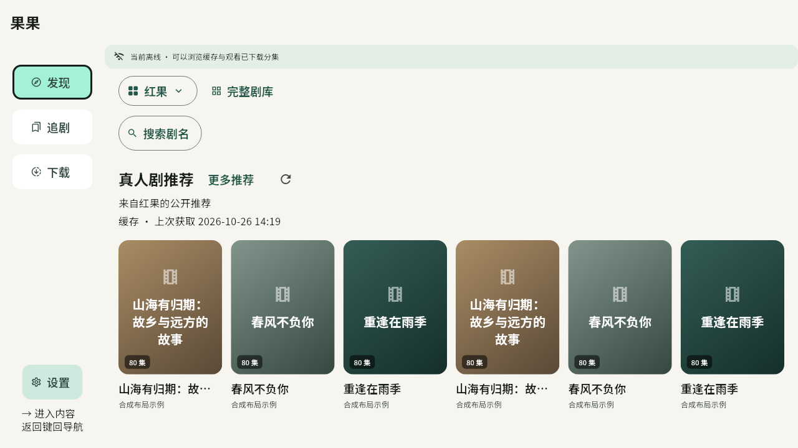

# 果果

暖白与墨绿的 Flutter 短剧应用，支持 iPhone、iPad、Android 手机与 Android TV／电视盒子。

> 开发版本。源码已接入十九站目录、原生播放与下载/投屏路径；具体安装包和验证结果以 GitHub Actions、Release 及 [实现状态](docs/implementation-status.md) 为准，源码接入不等于真机验收通过。

## 界面预览

以下为当前导航的布局示例（2026-10-09），使用示例内容，不是站源实测截图。

 

Android TV 界面布局示例（2026-10-26，合成内容，主机渲染；[遥控器导航说明](docs/tv-remote-navigation.md)）：



## 当前开发约定

按全新安装维护：记录使用 `records.json`，可重建缓存使用 `catalog-cache.json`；记录备份只接受和生成 v2，不导入旧 `state.json`。旧文件不会自动删除。

当前行为见 [产品规格](docs/product-spec.md)，验证与限制见 [实现状态](docs/implementation-status.md)，历史版本说明见 [更新记录](CHANGELOG.md)。

## 使用方式

- 发现、追剧、下载为主导航；发现保留推荐、榜单、完整剧库及独立搜索入口，追剧提供最近续播与明确的记录操作。
- 十九站分别浏览，可管理常用、最近和隐藏站源；皮果、牛果、超果、爽果默认停用，可在站源管理恢复，原因见[修复记录](docs/source-repairs-2026-10-25.md)。收藏、历史和下载支持“全部站源”筛选。联网搜索和本地缓存筛选按站源能力区分。
- 选集、上下滑切集、续播、倍速、画中画；单击切换控件，普通横滑预览进度，长按临时加速，并保留明确的播放和相邻分集控件。
- 浅色、深色、跟随系统；按可用窗口切换侧栏与底部导航，保留页面状态，支持大字号和读屏操作。
- 下载按剧分组，展开后可操作分集与滑动删除；保留选定范围/整剧下载、离线播放、筛选与批量重试，以及次级空间管理。设置提供真实统计范围与安全清理，记录备份包含收藏、历史和新季提醒。
- 统一设备入口提供 iOS AirPlay、Google Cast、DLNA 及进度交接。Cast/DLNA 手机中转需保持前台；AirPlay 独立原生队列的后台与接收器兼容性仍需真机验收。
- 站源解析嵌入应用内，不需要部署电脑或业务服务器。

## 安装 iOS 开发版本

1. 打开本仓库 [Releases](https://github.com/maxduke/guoguo-mobile/releases/latest)，下载对应版本的 `Guoguo-版本+构建号-ios-unsigned.ipa`。
2. 可使用同页 `SHA256SUMS` 核对文件完整性，`build-info.json` 可查询源码提交与构建记录。
3. 使用自己的签名工具和 Apple 账户重新签名后侧载到 iPhone / iPad。

未发布的开发构建会尝试在通过的 main 或手动 `CI` 运行中提供 `Guoguo-iOS-unsigned` artifact，保留 7 天。存储额度不足或上传失败时，该下载副本不可用，运行摘要会提示；源码检查、iOS 构建和包身份校验仍必须通过。PR 执行相同检查和构建，但不上传 IPA。正式版本直接上传 GitHub Release，不占用 Actions 中转产物存储。

IPA 未签名，不能直接点击安装。签名工具、账号与证书均由使用者管理，不存入仓库。自签后需实测本地网络发现、画中画及后台下载。

## 发布新版

1. 更新 `pubspec.yaml` 中的版本和递增构建号，新增 `releases/v版本.md` 更新说明。
2. 提交并推送源码，等待常规 CI 检查通过后合并到 `main`。
3. 对需要发布的提交创建并推送版本标签，例如 `git tag v0.3.0`、`git push origin v0.3.0`。
4. 标签触发 `Release`，先执行与普通 CI 相同的源码检查，再在同一个 macOS 任务中构建 iOS 包及已启用签名配置的 Android APK，核对版本、提交、签名及校验和，直接上传本次构建的文件。全部附件上传完成前保持草稿状态，发布不依赖 Actions 中转产物或历史 main CI 包。

构建或上传失败可重跑失败的发布任务；它会重新构建并校验同一标签的安装包，再继续上传草稿附件，不会回退到其他运行或提交的安装包。新流程仅对包含新工作流的提交生效，旧提交上的 tag 仍使用当时的工作流。

标签必须匹配源码版本，安装包内部版本及构建号也必须一致。普通分支、PR 和手动 CI 运行不会发布；失败运行可重试，已公开版本的附件不会自动覆盖。发布标签不应移动或复用，修复已发布版本时递增版本号。

## 本地开发

工具版本与 CI 对齐：Flutter 3.47.4、Go 1.27.1。iOS 原生编译需要 macOS、Xcode 和 CocoaPods。

```bash
python3 scripts/prepare_player.py
flutter pub get
scripts/setup_core.sh
scripts/build_core.sh ios
flutter config --no-enable-swift-package-manager
scripts/prepare_ios_media.sh
python3 scripts/prepare_ios_player.py
flutter build ios --release --no-codesign
```

`prepare_ios_media.sh` 在构建时准备依赖包提供的原生 FFmpeg 库；应用运行时不会下载或启动桌面可执行文件。

`prepare_player.py` 下载并校验锁定的 BetterPlayer 1.4.1 包，在 `.dart_tool/player` 生成带 Dart 轮询修复的副本；`pubspec.yaml` 的路径覆盖确保后续 `flutter pub get`、分析、测试与构建继续使用该副本。首次检出或 `flutter clean` 后先运行此脚本。共享 pub 缓存和个人 `pubspec_overrides.yaml` 不会被修改；个人配置如覆盖 BetterPlayer，脚本会明确拒绝冲突。

`prepare_ios_player.py` 校验锁定的播放器源码并生成仅供 CocoaPods 使用的 iOS 修复副本，依赖缓存保持原样；Podfile 也会在安装依赖时准备该副本。当前 iOS 构建使用 CocoaPods，保持 Swift Package Manager 关闭。

Android 的构建、安装、固定签名与遥控器使用见 [Android／TV 说明](docs/android-tv.md)。同一 APK 包含三种架构；正式包与开发测试包分开安装，具体设备的播放与后台行为仍需验收。

## 检查

```bash
flutter analyze
flutter test --concurrency=1
cd native/core
go test ./mobile ./internal/app
```

各站目录手动实测（不在 CI 自动访问站源）：

```bash
cd native/core
go run ./cmd/probe -source hongguo
go run ./cmd/probe -source huangdou
go run ./cmd/probe -source huangguo
```

## 目录

| 目录 | 职责 |
| --- | --- |
| `lib/domain` | 站源、短剧、分集、观看记录、备份模型 |
| `lib/data` | 缓存、收藏/历史持久化、下载任务与恢复 |
| `lib/ui` | 手机/平板界面与播放器 |
| `lib/platform` | 原生桥接、媒体准备、局域网投屏 |
| `packages/guoguo_core` | Swift/Kotlin 平台插件 |
| `native/core` | 从参考项目复用的 Go 解析核心与移动端接口 |
| `docs` | 当前规格、工程边界、性能证据、验收与历史档案 |

## 文档

- [当前产品规格](docs/product-spec.md)
- [实现状态与已知限制](docs/implementation-status.md)
- [状态职责与页面更新边界](docs/app-state.md)
- [性能基线与取舍](docs/performance-baseline.md)
- [iPhone / iPad 真机验收](docs/ios-device-checklist.md)
- [Android 手机／电视使用与构建](docs/android-tv.md)
- [历史规划与实施记录](docs/archive/README.md)
- [架构决策](docs/adr/0001-standalone-mobile-app.md)
- [领域术语](CONTEXT.md)
- [参考代码来源](native/core/UPSTREAM.md)
