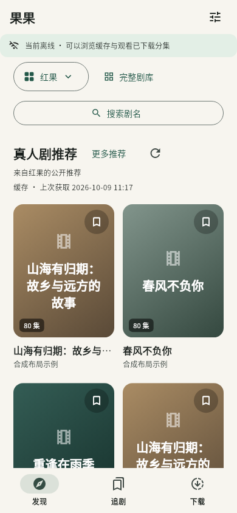
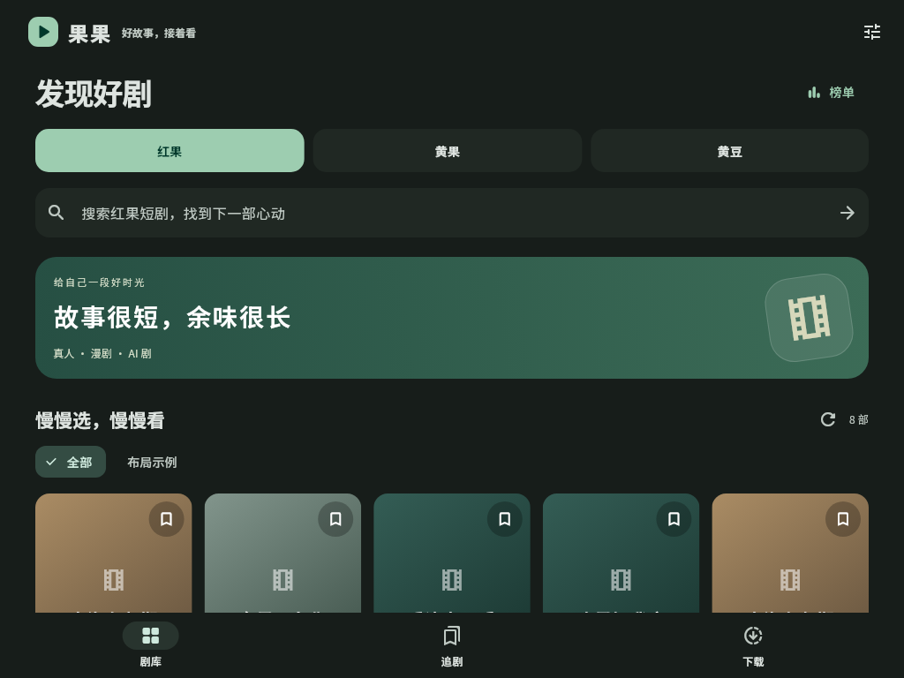

# 果果

暖白与墨绿的 Flutter 短剧应用。以 iPhone、iPad 为当前交付重点，Android 工程保留。

> 开发版本。源码已接入三站目录、原生播放与下载/投屏路径；具体 iOS 安装包和验证结果以 GitHub Actions 及 [实现状态](docs/implementation-status.md) 为准，源码接入不等于真机验收通过。

## 界面预览

以下使用明确标注的布局示例内容，不是站源实测截图。

 

## 使用方式

- 剧库按红果、黄果、黄豆分别浏览；收藏、历史和下载跨站汇总。
- 选集、上下滑切集、续播、倍速、画中画；单击切换控件，左右滑动预览进度，长按 2 倍速，长按后左右滑动快进/快退。
- 榜单采用大封面与排名卡片；黄果、黄豆以及历史/下载记录会自动补取缺失或过期的封面。
- 浅色、深色、跟随系统，手机与平板布局。
- 分集与整剧下载、直接播放、滑动删除；按剧统计空间和大小排序，跨状态整剧多选删除，按失败/暂停状态筛选与批量重试；离线浏览、记录备份与导入。
- iOS AirPlay；Google Cast、DLNA 设备发现与在线投屏。
- 站源解析嵌入应用内，不需要部署电脑或业务服务器。

## 安装 iOS 开发版本

1. 打开本仓库 [Releases](https://github.com/maxduke/guoguo-mobile/releases/latest)，下载对应版本的 `Guoguo-版本+构建号-ios-unsigned.ipa`。
2. 可使用同页 `SHA256SUMS` 核对文件完整性，`build-info.json` 可查询源码提交与构建记录。
3. 使用自己的签名工具和 Apple 账户重新签名后侧载到 iPhone / iPad。

未发布的开发构建仍可在通过的 `CI` 运行中下载 `Guoguo-iOS-unsigned` artifact，保留 14 天。Release 附件不受该保留期影响。

IPA 未签名，不能直接点击安装。签名工具、账号与证书均由使用者管理，不存入仓库。自签后需实测本地网络发现、画中画及后台下载。

## 发布新版

1. 更新 `pubspec.yaml` 中的版本和递增构建号，新增 `releases/v版本.md` 更新说明。
2. 提交并推送源码，等待该提交在 `main` 上的 push CI 检查和 iOS 构建通过。
3. 对同一提交创建并推送版本标签，例如 `git tag v0.3.0`、`git push origin v0.3.0`。
4. 标签仅触发 `Release` 工作流：查找同一提交已成功的 `main` push CI，复用其 IPA，核对版本、提交及 SHA-256 校验和后发布；不重复测试或 iOS 构建，上传完成前保持草稿状态。

若标签先于 CI 完成，待 CI 成功后重跑失败的 Release；若构建产物已超过 14 天保留期，先重跑该提交的 main push CI，再重跑 Release。不会回退到其他提交的安装包。

标签必须匹配源码版本，安装包内部版本及构建号也必须一致。普通分支、PR 和手动 CI 运行不会发布；失败运行可重试，已公开版本的附件不会自动覆盖。发布标签不应移动或复用，修复已发布版本时递增版本号。

## 本地开发

工具版本与 CI 对齐：Flutter 3.47.4、Go 1.27.1。iOS 原生编译需要 macOS、Xcode 和 CocoaPods。

```bash
flutter pub get
scripts/setup_core.sh
scripts/build_core.sh ios
flutter config --no-enable-swift-package-manager
scripts/prepare_ios_media.sh
flutter build ios --release --no-codesign
```

`prepare_ios_media.sh` 在构建时准备依赖包提供的原生 FFmpeg 库；应用运行时不会下载或启动桌面可执行文件。

Android 暂未完成验收。配置 Android SDK/NDK 后可使用 `scripts/build_core.sh android` 构建桥接库。

## 检查

```bash
flutter analyze
flutter test --concurrency=1
cd native/core
go test ./mobile ./internal/app
```

三站目录手动实测（不在 CI 自动访问站源）：

```bash
cd native/core
go run ./cmd/probe -source hongguo
go run ./cmd/probe -source huangdou
go run ./cmd/probe -source huangguo
```

## 目录

| 目录 | 职责 |
| --- | --- |
| `lib/domain` | 站源、短剧、分集、观看记录、备份模型 |
| `lib/data` | 缓存、收藏/历史持久化、下载任务与恢复 |
| `lib/ui` | 手机/平板界面与播放器 |
| `lib/platform` | 原生桥接、媒体准备、局域网投屏 |
| `packages/guoguo_core` | Swift/Kotlin 平台插件 |
| `native/core` | 从参考项目复用的 Go 解析核心与移动端接口 |
| `docs` | 需求、ADR、验收场景与实现状态 |

## 文档

- [首版规格](docs/v1-spec.md)
- [实现状态与已知限制](docs/implementation-status.md)
- [移动端技术调研](docs/mobile-feasibility.md)
- [领域术语](CONTEXT.md)
- [参考代码来源](native/core/UPSTREAM.md)
