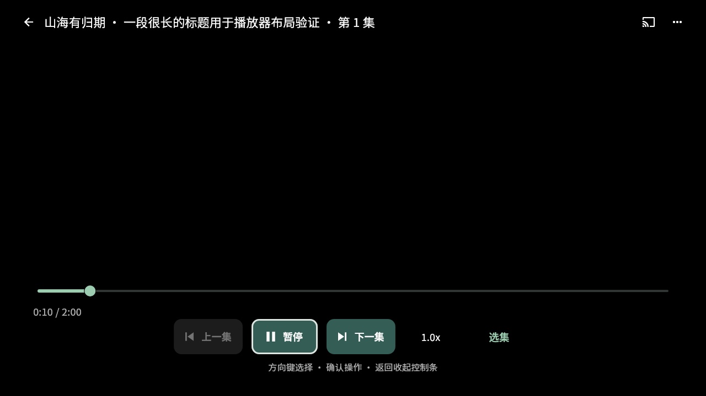

# 电视播放页修复

用户在 Android 9／10 电视的 v0.20.2 上使用红果时，能听到声音并操作控制条，画面仍为封面或带剧名的背景，没有转圈或加载文字。尚未取得设备型号、具体分集或原机日志，因此不能将某种硬件解码器或 Flutter 渲染后端认定为原因。

## 已确认并修复的问题

- 遥控器启用状态切换会改变 `Focus` 包装层，导致视频子树被移出后重新挂载。回归在修改前观察到一次 `deactivate`；改为保留同一包装层后，禁用再启用遥控器不再触发视频子树移出。菜单、后台恢复及播放控件不再通过改变层级干扰视频视图。
- TV 进度条沿用触屏导航模式，上下键会调节数值，阻止用户通过方向键移动到顶部操作。电视环境现在使用 Flutter 的方向导航模式；左右键调节进度，上下键移动焦点。
- 独立的原生暂停可能不触发整个播放页重建，媒体播放／暂停键因此读取旧状态。按键现在读取当前播放器状态。

## 播放页调整

电视仅显示当前集的状态层，换集直接切换当前集，不再叠加手机的纵向分集翻页视图。视频视图保持独立，准备完成后移除当前集封面。手机继续使用原翻页体验。

播放、上一集、下一集采用带文字的大按钮，开播或重新显示控件时默认聚焦播放按钮。标题、进度和倍速文字放大；主要控件留出屏幕边缘空间。返回先收起控制条，再退出播放；加载和错误状态保留直接退出能力。

电视选集和设置使用居中面板，默认聚焦当前分集；设置展示遥控器说明，隐藏横竖屏及手势锁定入口。控件和视频视图不会因为打开、关闭面板而重新创建。

## 验证范围

自动化回归使用模拟的原生播放器事件，覆盖当前集封面移除、非零尺寸视频 Texture、开播焦点、确认播放／暂停、方向键换集、进度条离焦、选集、设置以及两步返回。布局预览覆盖 1280×720 和 960×540 的电视窗口及 1.5 倍文字。预览中的视频为空白，不能用作实际播放画面的证明。

全套回归还暴露了既有性能样本的缓存收尾问题：图片库的 `dispose()` 只关闭数据库，未取消已安排的清理计时器。样本现在先移除海报，并在测试时钟上完成缓存清理，再关闭数据库。控件数量、惰性挂载及测量断言保持原样。

主机没有 KVM 访问权限。API 36 Google TV 软件模拟器进入 QEMU 并被 ADB 发现，但 15 分钟内系统未完成启动，已停止；未安装 APK，未取得播放或视频 Texture 合成证据。该模拟器本身也不能代替用户的 Android 9／10 电视验收。

首次 UI 改动没有更换播放器或修改 Android 渲染配置。用户后续复测确认仍有问题，不能把上述主机回归写成设备问题已经解决。

## 2026-10-26 设备复测与兼容构建

用户确认使用“果果 测试”0.20.3，红果所有剧集均受影响。截图中，《医院逃生：我能推理无限》第 25 集在正常 TV 控制条下面显示绿色横向碎块，进度为 0:02／1:03；《归墟环》第 29 集仍显示渐变和居中片名，进度为 0:09／1:00。TV 导航与控制条布局已经启用，不能再把问题仅归结为手机布局覆盖。

同标题、集数的主机抽查表明，《归墟环》第 29 集可用的 1080／720／540／480／360P 都是 HEVC Main、8 位、30fps，各档完整准备与软件解码通过；这些主机结果不代表电视硬件解码或纹理合成正常。《医院逃生》第 25 集的原生模型中，低档为 bytevc2，1080P 为 bytevc1；当前实现已跳过 bytevc2。改变 `use_os_player`、`device_level`，或读取模型自带的 fallback API，并未取得 H.264 线路。因此没有声称降低清晰度或“强制 AVC”一定能修复，也没有向客户端传递虚构的兼容资源。

新构建 0.20.3+55 仅在原生系统报告 TV 模式时，启动 Flutter 的旧版 OpenGL 渲染路径，以验证传统 SurfaceTexture 与电视图形驱动的兼容性。普通 Android 手机的引擎参数保留原样；不替换视频播放器、不转码，也不改变红果资源选择。已按 Flutter 3.47.4 的 Activity → EngineGroup → FlutterLoader 源码核对该启动参数在 AOT release 中仍允许，且位于 manifest 参数之后。参考：[Impeller 配置](https://docs.flutter.dev/perf/impeller)、[FlutterShellArgs](https://github.com/flutter/flutter/blob/3.47.4/engine/src/flutter/shell/platform/android/io/flutter/embedding/engine/FlutterShellArgs.java)。

“更多播放设置 → 画面状态”新增本地状态快照：白名单内的设备型号、系统、ABI、应用身份／构建号和请求的渲染配置；播放器准备、初始化、尺寸、进度，以及当前逻辑封面状态。快照不采集播放 URL、内容密钥、剧名、设备标识符或异常原文；设备通道失败仍保留播放状态。遥控器可逐行浏览并复制，不重建视频视图。

此构建是定向兼容测试，原机验收仍未完成。Android 9 默认已使用旧版 OpenGL，此时切换参数可能无效；即使硬件解码失败，播放器初始化和时间前进也不等于视频已经显示。若仍异常，应结合新状态页的设备／API 与播放器信息继续定位，而不是将单张截图直接认定为某个 decoder 或 Impeller 的已确认缺陷。
