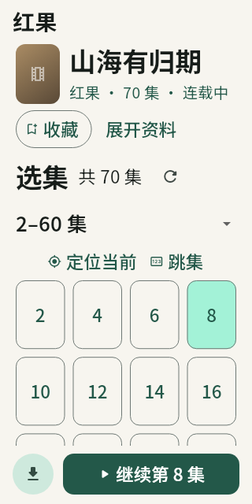
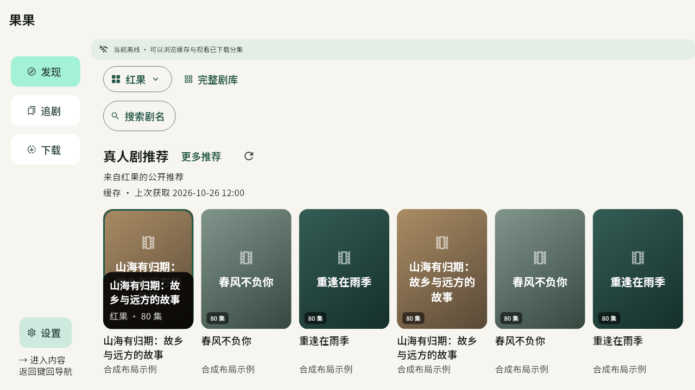

# 手机与 TV UI/UX 修复

基于 `0.20.3+57`、`69053bbab4c07c480c27025f3e32710e1b1254ef`，在 `fix/phone-tv-ui-ux` 工作分支落实[审查清单](ui-ux-review-2026-10-26.md)的九项改动。以下描述本轮工作区实现，发布版本以对应 Release 为准。

## 用户可见变化

| 项目 | 修复后的行为 | 主要回归 |
| --- | --- | --- |
| 手机定位当前集 | 切回所在范围并滚到当前分集，保留观看进度与播放意图；仅为当前页最多 30 集保留定位键和布局缓存。 | [详情选集](../test/detail_episode_ux_test.dart)覆盖首集、页尾和其他范围的定位，以及底部操作栏遮挡。 |
| 搜索状态 | 未提交时提示搜索当前站源；失败显示未完成和重试；搜索成功且无结果才显示未找到。离线／本地筛选沿用对应范围。 | [搜索状态](../test/catalog_search_state_test.dart)覆盖未提交、联想失败、搜索失败、重试、空结果和输入法组合态。 |
| 切站保留关键词 | 保留输入、光标和组合态，取消旧站请求并清除旧结果，用户明确搜索新站；迟到响应不能混入新来源。 | [搜索状态](../test/catalog_search_state_test.dart)验证保留关键词、取消身份、迟到结果及新站请求范围。 |
| TV 控制条换行 | 左右键只在同一视觉行移动，上下键到相邻行；跳过禁用项，行边缘不横跳。 | [方向导航](../test/player_transport_direction_test.dart)覆盖四种窗口／字号和首集禁用；[完整播放器](../test/tv_player_presentation_test.dart)覆盖 720×480 下进入／退出选集及同一视频视图保留。 |
| 有线预缓冲 | Wi-Fi 与有线网络均可按默认偏好准备下一集；存在移动网络时继续要求用户允许，未知网络不自动放行。设置显示真实默认范围。 | [网络策略](../test/network_policy_test.dart)覆盖有线、VPN、移动网络并存和离线结果。系统后台下载的网络条件沿用原实现。 |
| 小屏大字号 | 首页把剧库与更多入口收紧为带标签的图标，把说明及完整缓存时间收进可展开状态；详情合并资料与操作，简介、标签仍可展开。 | [布局](../test/adaptive_layout_test.dart)验证 320×640、2 倍字体下首屏可见海报与缓存说明；[详情](../test/detail_episode_ux_test.dart)验证 VIP 长标题和 1.6 倍字号下可直接操作分集。 |
| 长标题与 TV 焦点信息 | 海报下剧名保留双行与一致高度，列数随字号变化；TV 聚焦海报时叠加更完整的剧名、站源和集数，不增加焦点停留点。 | [卡片](../test/drama_card_layout_test.dart)覆盖聚焦／失焦、确认打开和信息展示；原读屏标签及触控目标断言继续保留。 |
| TV 收藏提示 | 空收藏提示改为打开详情后收藏，与遥控器实际可用入口一致。 | 对照现有海报单焦点与详情收藏入口核对。 |
| 记录撤销 | 取消收藏、删除历史后显示带剧名的八秒撤销入口；恢复原进度与时间。撤销只补回缺失记录，保留后来产生的收藏与进度；写入失败提供重试。 | [记录撤销](../test/record_undo_test.dart)与[记录事务](../test/record_transactions_test.dart)覆盖写入期间不可见、失败不安装、重启后持久化、新记录保护和实际页面操作。 |

## 当前布局预览

以下使用合成内容和主机中文字体，不是手机或电视实流截图。

320×640 的大字号首页与详情：

 

TV 聚焦海报时的完整资料区域：

## 验证范围

本轮格式与静态分析通过；Flutter 全量回归 **993 项通过，零失败、零跳过**，耗时 6 分 47 秒，启用中文预览、实际 FFmpeg 媒体命令及主机性能样本。故障修正后的定向复验 19 项通过；当前记录撤销套件单独复验 8 项通过。各组有重叠，不累加为独立用例总数。结果及环境见[验证记录](ui-ux-fixes-2026-10-26-checks.json)。性能样本用于回归覆盖，没有据此宣称手机或电视更快。

预览和渲染基线在退出前等待实际图片加载与缓存读取完成，再推进 CacheStore 的十秒清理定时器并关闭数据库。TV 字号测试先设置字号，再启用方向导航模式；来源隔离断言保留并更新为切站保留关键词。没有删除断言或忽略失败。

本轮没有执行 iOS／Android 安装包构建，也没有连接实体设备。原电视仍需验证实际遥控器映射、网线连接下的连续播放与大字号菜单；手机仍需验证系统输入法、读屏和投屏等平台交互。主机模拟播放器不代替这些设备结果。
